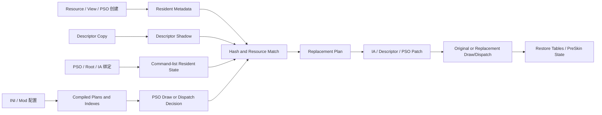

# DX12 Mod 替换架构与性能完整报告

日期：2026-07-26  
当前状态：稳定基线，descriptor 结构重构已回退  
当前 Release Timing DLL SHA256：`399D6F9BE381C87C8943F60CAFFE160B7E2D18D543EB8B5A9464F93FB02104E3`

## 1. 结论摘要

当前实现已经接近“现有架构、完整功能和低风险约束下的局部最优”，但不能称为 DX12 Mod 替换的全局最优。

已基本达到当前结构下限的部分：

- Descriptor 创建、复制、当前值传播和 Hash 查询。
- IA 资源定位、resident resource publication 和内容 generation 验证。
- PSO 静态决策、IA candidate prefilter、negative cache。
- Root/IA 冗余状态维护抑制。
- PreSkin 的精确依赖验证和稳定正负缓存。
- Draw SRV patch 的临时 heap、table mirror 和 restore 正确性。

仍有结构性优化空间的部分：

1. Draw 时仍执行多层动态决策、dependency key、candidate cache 和 command execution。
2. Descriptor copy 中约 59% slot 是实际变化，单槽缓存无法消除必要传播。
3. PreSkin collect/prepare 仍有毫秒级成本。
4. COM wrapper/object lifetime 仍约 1.4 ms/frame。
5. Capture/Hunting 与正常 Mod 模式共享部分基础设施，增加常驻复杂度。

因此当前版本适合作为稳定发布基线。下一档明显收益需要改变工作发生的时机和所有权，而不是继续增加 slot cache、memo 或原子字段。

## 2. 报告范围与测量口径

本报告覆盖：

- Shader/PSO 替换。
- Draw、DrawIndexed、Dispatch hook。
- IB/VB Buffer Hash 匹配与替换。
- CBV/SRV/UAV Buffer 查询与替换。
- 显式 `vs-tN` / `ps-tN` 槽位贴图替换。
- Resource Hash 和 Descriptor Hash 贴图替换。
- `CheckTextureOverride` 和 `this` 语义。
- PreSkin UAV producer、SRV/CBV 输入、输出 resize、替换和恢复。
- Descriptor heap shadow、copy、history 和生命周期。
- Root signature、root table、root descriptor 和 root constants。
- ExecuteBundle、Reset、Capture、Hunting、Frame Analysis。
- Resident resource、GPUVA、barrier state 和 content generation。
- 已验证优化、失败实验、热点和后续路线。

性能比较统一使用 `frameWallUs` 在 45–60 ms 的帧，避免菜单、加载、卡顿和极端帧污染。除非特别说明，所有数值都是每帧均值。

当前回退构建清理了运行日志，因此稳定基线定量结果采用此前已验证的 `D295…37EF` 样本；当前 `399D…04E3` 是该重构回退后的重新构建产物。

## 3. DX11 与 DX12 的根本差异

DX11 的驱动/runtime 持有隐式绑定状态，view 是可直接识别的对象。Mod 可以在 Draw 时从当前 view/resource 获取资源 Hash，再做直接 override lookup。

DX12 将状态显式化：

- Root table 只有 GPU descriptor handle。
- API 不提供从 descriptor handle 反查 descriptor 内容的能力。
- Descriptor 可以先在 CPU heap 创建，再经过多次 copy，最后进入 shader-visible heap。
- Command list 可以并行录制、Reset、复用和 ExecuteBundle。
- 资源内容可以通过 Copy、Map/Unmap、UAV、Resolve 等路径变化。

因此以下成本不是简单的实现失误，而是支持完整 DX12 替换所需的基础设施：

- Descriptor 创建和 copy shadow。
- Root signature layout 解析。
- Command-list resident state。
- GPUVA 到 resource 的索引。
- Resource lifetime/content generation。
- Draw/Dispatch 前的精确依赖验证。

真正需要优化的是这些信息如何存储、何时验证，以及能否把 Draw 时工作提前到状态变化时。

## 4. 总体数据流

主要代码所有权：

- 配置和编译：[DX12ModConfiguration.inl](../src/DirectX12/Implementation/DX12ModConfiguration.inl)
- Mod 常驻状态：[DX12ModState.inl](../src/DirectX12/Implementation/DX12ModState.inl)
- Draw/Dispatch hook：[DX12CommandFlow.hpp](../src/DirectX12/Hooks/DX12CommandFlow.hpp)
- Command-list resident state：[DX12CommandRuntime.hpp](../src/DirectX12/Commands/DX12CommandRuntime.hpp)
- Resident state 实现：[DX12CommandRuntime.inl](../src/DirectX12/Implementation/DX12CommandRuntime.inl)
- Command VM 和匹配：[DX12CommandExecution.inl](../src/DirectX12/Implementation/DX12CommandExecution.inl)
- IA Hash 和 TextureOverride：[DX12IaRuntime.inl](../src/DirectX12/Implementation/DX12IaRuntime.inl)
- Draw SRV patch：[DX12DrawReplacement.inl](../src/DirectX12/Implementation/DX12DrawReplacement.inl)
- PreSkin：[DX12PreSkinRuntime.inl](../src/DirectX12/Implementation/DX12PreSkinRuntime.inl)
- Descriptor runtime：[DX12DeviceRuntime.hpp](../src/DirectX12/Runtime/DX12DeviceRuntime.hpp)
- Descriptor/resource core：[DX12ResourceInfrastructure.hpp](../src/DirectX12/Tracking/DX12ResourceInfrastructure.hpp)
- Binding tracker：[DX12BindingState.inl](../src/DirectX12/Implementation/DX12BindingState.inl)

## 5. 配置编译与运行时快照

配置 reload 时会预编译：

- ShaderOverride plan。
- TextureOverride plan。
- CommandList plan。
- IA index/vertex candidate indexes。
- 按 index count、vertex count 和 slot 的 prefilter indexes。
- Descriptor-triggered TextureOverride indexes。
- PreSkin UAV Hash 和 `match_cs` indexes。
- 各 action 是否需要 IA、descriptor、Draw 或 Dispatch 动态状态。

运行时通过 immutable/shared snapshot 发布新配置，避免 Draw/Dispatch 在全局配置锁下解释所有 INI 数据。

关键失效边界：

- Reload generation 变化。
- Shader/TextureOverride map 重建。
- Loaded resource 释放和重新加载。
- PSO replacement generation 更新。
- PreSkin cache generation 更新。

正确性要求：

- 旧 snapshot 必须在使用者完成后才释放。
- 所有缓存 key 必须包含 reload generation，或在 reload 时完整清空。
- 不支持的 command action 必须回退解释器，不能静默跳过。

## 6. Shader 与 PSO 替换

### 6.1 功能

- Graphics PSO shader replacement。
- Compute PSO shader replacement。
- ShaderOverride `handling=skip`。
- ShaderOverride pre/post command lists。
- 延迟创建 replacement PSO。

### 6.2 当前快路径

- PSO metadata 在创建时记录。
- `DX12CompiledDrawDecision` 和 `DX12CompiledDispatchDecision` 按 PSO/reload generation 缓存。
- 无 shader override、无 descriptor match、无 IA match 时直接 fast-forward。
- Replacement PSO 的 no-op generation 被缓存，避免重复构建失败或重复判定。

### 6.3 正确性边界

- PSO pointer 生命周期。
- Reload generation。
- Graphics/Compute PSO 类型。
- Original shader bytecode/hash 与 replacement 的对应关系。
- Replacement 创建失败必须保留原 PSO。

## 7. Command-list Resident State

`DX12SimulateContext` 保存：

- 当前 PSO。
- Graphics/Compute root signature。
- CBV/SRV/UAV 与 sampler descriptor heap。
- Graphics/Compute root tables。
- Root CBV/SRV/UAV descriptors。
- Root constants。
- IB/VB views。
- Primitive topology。
- 各类 binding revision、query serial 和 cache identity。
- 已解析 Draw/Dispatch decision 和 negative state。

### 7.1 已实现优化

- TLS command-list lookup。
- Direct/sharded runtime lookup。
- 相同 PSO、root signature、root table、root descriptor、IB/VB 和 topology 不重复维护。
- Root signature 变化时只清理受影响的 root state。
- Root table 使用 runtime heap summary 延迟解析。
- Reset 和 ExecuteBundle 边界执行保守失效。

### 7.2 不能删除的边界

- `SetDescriptorHeaps` 会使先前 table 与 heap 的关联发生变化。
- Root signature 变化会重新定义 root parameter layout。
- Reset 必须清除所有 resident decision。
- Bundle 可以引入调用方无法提前看见的状态变化。
- 未知 command list 状态必须回退保守路径。

## 8. IA Buffer Hash 与替换

### 8.1 支持范围

- Index Buffer Hash 匹配。
- 指定 Vertex Buffer slot Hash 匹配。
- 任意 Vertex Buffer slot 匹配。
- Index/vertex count、instance count、first index/vertex/instance 条件。
- IB/VB replacement resource。
- Replacement draw/dispatch 和 `draw=from_caller`。

### 8.2 数据依赖

- D3D12 IB/VB view。
- GPUVA 对应 resource。
- Resource lifetime generation。
- Resource content generation。
- View offset、size、stride 和 format。
- Draw 参数实际访问区域。

### 8.3 当前缓存层

- Compiled target plan，只解析配置真正需要的 IB/VB slot。
- GPUVA TLS cache。
- Resident resource publication token。
- IA exact dependency key。
- Thread-local IA Hash state cache。
- Direct IA candidate cache。
- Resident exact-negative cache。
- PSO/view negative cache。

### 8.4 已验证收益

- Direct IA misses：约 `359 -> 80.5/frame`，下降约 78%。
- Direct IA evictions：约 `356 -> 74.8/frame`，下降约 79%。
- DrawHook normalized：约 `5.07 -> 4.65 us/call`，下降约 8%。
- DrawHook 总成本：约 `9.32 -> 8.75 ms/frame`。

### 8.5 剩余问题

即使 Hash state 命中，Draw 仍需验证 dependency key。当前架构把资源内容正确性验证放在 Draw；真正的下一步应让资源写入路径发布完整 content token，使 Draw 只比较已绑定资源 token。

## 9. Descriptor Shadow

### 9.1 为什么必须存在

D3D12 无法从 descriptor handle 反查：

- 对应 resource。
- SRV/UAV/CBV view desc。
- Buffer offset、size、stride。
- Texture format、dimension、mip 和 array 信息。

如果不在 `Create*View` 和 `CopyDescriptors*` 时记录并传播这些信息，以下功能会失效：

- CBV/SRV/UAV Buffer 替换。
- 槽位 TextureOverride 的 `CheckTextureOverride`。
- Resource Hash 贴图替换。
- Descriptor Hash 贴图替换。
- `this` resource 替换。
- PreSkin UAV/SRV/CBV 查询。
- Capture/Hunting descriptor history。

### 9.2 当前模型

- 已知 heap 使用直接 heap-slot shadow。
- 普通 Mod 模式使用 compact descriptor value node。
- Copy 可以共享 immutable value node，避免复制完整 `DescriptorRecord`。
- CBV 有专用 Hash 和紧凑创建路径。
- Heap slot 维护 value identity/version。
- Copy range 使用 identity preflight、range memo 和分片锁。
- 未能解析到已知 heap 的 CPU handle 使用兼容 ledger。
- Capture/Frame Analysis 按需维护 epoch history。

### 9.3 Copy 的 D3D12 语义要求

- Copy 必须捕获调用时 source value。
- Source 后续覆盖不能改变 destination。
- Overlap copy 必须先 snapshot source。
- Missing source 必须清除 stale destination。
- Heap 销毁和地址复用不能造成 ABA。
- Query 不能看到一半发布的 descriptor value。

### 9.4 当前性能

稳定基线：

- `CopyDescriptorsWrapper.record`：约 4.05 ms/frame。
- 约 1.15 us/call。
- `DescriptorCbvWrapper.record`：约 1.75 ms/frame。
- 两者合计约 5.8 ms/frame。

工作负载特征：

- 每帧约 3.5K Copy API calls。
- 每帧约 18–19K copied slots。
- 失败重构样本中约 59% slot 确实发生变化。
- 因此单纯增加 negative memo 的收益有明确上限。

### 9.5 已验证优化

- 删除 duplicate single-descriptor preflight。
- Identity fast path 只解析/比较一次。
- CBV 延迟 materialize，确认需要写入后再构造 value。
- Immutable value node sharing。
- Shared node copy retain/release。
- Unique node 原地更新。
- 连续 range 合并和锁批处理。
- Copy telemetry 批量提交，避免诊断原子操作污染热点。

### 9.6 已回退实验

`3767…110D` 尝试把 value pointer、valueId 和 ABA-safe revision 合并进 sparse slot，并增加 atomic occupancy、tombstone revision 和生命周期处理。

结果：

- Copy record：`4.05 -> 4.20 ms`，回退约 3.7%。
- Copy normalized：`1.15 -> 1.192 us/call`，回退约 3.6%。
- CBV record：`1.752 -> 2.303 ms`，回退约 31.4%。
- Copy + CBV：约 `5.802 -> 6.503 ms`，回退约 12.1%。
- Frame：`50.10 -> 51.373 ms`，回退约 2.5%。

原因：

- 没有消除现有锁和 heap version，只增加了另一组热点原子访问。
- Slot/page 体积扩大，缓存局部性下降。
- 高频 CBV 创建对原子 publication 最敏感。
- 大量 copy 是真实变化，pointer sharing 仍需引用计数和 publication。

结论：冻结当前 descriptor slot 架构。不要继续增加 per-slot revision、memo ways 或重复 identity 层。

## 10. 显式槽位贴图替换

支持：

- `vs-tN = ResourceX`。
- `ps-tN = ResourceX`。
- `this = ResourceX` 类 matched descriptor replacement。

执行流程：

1. 从 root signature 获取 descriptor range layout。
2. 从 resident root table 和 bound heap 解析目标 GPU/CPU slot。
3. 收集需要 patch 的 SRV binding。
4. 构建临时 shader-visible descriptor heap。
5. Mirror 所有仍需保持有效的 table。
6. 用 replacement SRV 覆盖目标 offset。
7. 绑定临时 heap/table。
8. 执行 Draw/Dispatch。
9. 恢复原始 heap/table。

不能只复制目标 descriptor。调用 `SetDescriptorHeaps` 后，所有依赖旧 heap 的 root table 都必须在新 heap 中有对应内容并重新绑定。

动态/unbounded range 最多按安全上限 mirror 65,536 descriptors。当前实际 workload 的 DrawSrv 只有约 36 descriptors、约 60–100 us/frame，不是主要热点。

## 11. Resource Hash 与 Descriptor Hash 贴图替换

### 11.1 Resource Hash

表示底层 resource 内容/身份，用于同一资源不同 view 的统一匹配。

依赖：

- Descriptor -> resource 解析。
- Resource metadata 和 texture hash generation。
- Resource 生命周期和更新传播。

### 11.2 Descriptor Hash

表示 resource 加 view 描述，用于区分：

- 不同 mip。
- 不同 array slice。
- 不同 format reinterpretation。
- 不同 buffer range/stride。

依赖完整 descriptor shadow，不能只保存 resource pointer。

### 11.3 匹配顺序

- 根据 draw count/配置建立允许 section 集合。
- 解析当前目标 binding。
- 计算/读取 resource hash。
- 计算 descriptor hash。
- 查 immutable runtime snapshot 的 Hash buckets。
- 过滤 draw context、slot、stage、register space 和 `match_cs`。
- 生成 pre/post runtime effects 和 replacement requests。

## 12. `CheckTextureOverride` 与 `this`

`CheckTextureOverride` 可以针对：

- IndexBuffer。
- VertexBuffer slot。
- ConstantBuffer slot。
- ShaderResource slot。
- UnorderedAccessView slot。

`this` 语义要求保留实际命中的 binding，包括：

- Stage。
- Shader register 和 register space。
- Root parameter/range。
- Descriptor offset。
- Table GPU/CPU base。
- Resource Hash 和 Descriptor Hash。

因此不能把 texture match 简化为单一 Hash lookup；后续 replacement 必须知道原匹配目标在当前 root layout 中的位置。

## 13. PreSkin 系统

### 13.1 功能

- 按 compute shader Hash 识别目标 Dispatch。
- 收集 UAV producer 输出。
- 收集 SRV/CBV/root constants 输入。
- UAV Hash 和 `match_cs` TextureOverride。
- PreSkin output resize / vertex limit raise。
- 临时 descriptor patch。
- Dispatch override 和 handling skip。
- 后续 Draw 的 IA redirect。
- Dispatch 完成后的状态恢复和资源延迟回收。

### 13.2 当前缓存

- Compiled PreSkin plan。
- Binding fingerprint。
- Stable dependency fingerprint。
- CBV read cache。
- SRV positive/negative cache。
- Stable SRV positive/negative cache。
- UAV match cache/LRU。
- Descriptor patch abort cache。
- Match-CS input cache。
- Descriptor table clone cache。
- Restore descriptor heap pool。

### 13.3 失效条件

- Compute PSO/CS Hash 变化。
- Root signature 或 root binding revision 变化。
- Descriptor slot identity/version 变化。
- Resource content generation 变化。
- Reload generation 变化。
- Command list Reset。
- ExecuteBundle 或未知状态。
- Active PreSkin section generation 变化。

### 13.4 剩余热点

已观察到 `collect_bindings`、prepare/fingerprint 和 probe work 仍可达到毫秒级。优化方向应是：

- 为每个 CS/PSO 编译精确 root dependency plan。
- 状态变化时增量更新 binding fingerprint。
- Dispatch 只比较 dependency revisions。
- 将完整 descriptor materialization 限制到真正 candidate Dispatch。

不能通过关闭 descriptor tracking 优化，否则 PreSkin Hash 和 patch 会静默失效。

## 14. Draw/Dispatch Hook

### 14.1 Fast-forward 层

当前首先检查：

- Global skip。
- Hot path flags。
- 是否有 Draw/Dispatch work。
- Resident fast reject。
- Hunting/Capture 是否需要记录。
- Shader override skip。
- PreSkin candidate。

完全无工作时直接调用 original API，不创建 executor。

### 14.2 Draw 剩余工作

需要 override 时可能依次经过：

- PSO compiled decision。
- Resident negative lookup。
- IA target plan filter。
- Direct IA candidate cache。
- Exact IA dependency key。
- IA Hash state cache。
- Descriptor target prefilter。
- Resource/descriptor Hash lookup。
- Compiled command plan 或 fallback interpreter。
- Replacement resource retention。
- IA/descriptor patch。
- Replacement Draw/Dispatch。
- Post command execution和 restore。

### 14.3 当前性能

- Mod-active indexed draws：约 1,166/frame；部分 cohort 总 DrawHook calls 约 1,882/frame。
- DrawHook：约 8.75 ms/frame。
- Normalized：约 4.65 us/call。

这是当前最大的可控热点。

## 15. Capture、Hunting 与 Frame Analysis

正常 Mod 模式和诊断模式目标不同：

- 正常模式只需要当前 descriptor/binding/resource state。
- Capture 需要事件时刻的 immutable snapshot。
- Hunting 需要 visited resource、shader、IB/VB 和可选择目标。
- Frame Analysis 需要 descriptor history、output binding 和 dump metadata。

关键策略：

- 正常模式避免完整 descriptor history。
- Capture 开启时记录 epoch 和 event ledger。
- Event 必须持有足够生命周期，不能引用随后被覆盖的 slot。
- Queue 提交、command list Reset 和 session ID 用于隔离旧事件。
- Internal replay 不能再次进入普通 hook 逻辑形成递归。

诊断模式不是普通性能基线，不能用 Capture/Hunting 帧判断正常 Mod FPS。

## 16. Resource、GPUVA 与生命周期

### 16.1 Resident resource index

记录：

- Resource pointer/canonical identity。
- D3D12 resource desc。
- Heap type。
- GPUVA start/end。
- Placed resource 可访问范围。
- Current barrier state。
- Lifetime generation。
- Content generation。
- Stable publication token。

### 16.2 已实现优化

- GPUVA TLS cache。
- Resolved IA L1/L2 cache。
- Stable per-resource atomic publication token。
- Barrier state 原子发布。
- 删除重复 GPUVA complete index。
- Cleanup 后 token 地址仍稳定。
- Canonical pointer cache 在适当边界清理。

### 16.3 正确性要求

- Resource pointer 地址复用不能命中旧 generation。
- Placed resource OOB 兼容范围不能越过 heap 边界。
- CPU upload、Copy、Resolve、UAV write 等内容变化必须推进 generation。
- Release tracker 必须在缓存仍可能读取时保留 publication lifetime。

## 17. Object Wrapper 与 COM Lifetime

当前 wrapper 用于拦截：

- Device 创建和 descriptor API。
- Command list 状态和 Draw/Dispatch。
- Command queue submit。
- Resource/heap/root signature/PSO 等必要对象行为。

已测 `WrapperLifetime/ObjectLifetime` 约 1.4 ms/frame。删除重复 registry erase 没有显著改善，说明成本主要来自：

- 实际 COM `AddRef/Release`。
- Wrapper registry。
- Wrapped/unwrapped identity 转换。
- 对象析构和 release tracker。

可能的长期方向是 sidecar tracking：只 wrapper 必须拦截方法的对象，其他对象返回原始 COM pointer，并通过 `SetPrivateDataInterface` 或稳定 sidecar 保存 metadata/lifetime callback。

风险很高：QueryInterface identity、游戏比较 pointer、跨接口版本和 wrapper unwrap 都必须保持兼容。因此该方向优先级低于 Draw plan。

## 18. 当前性能排行

以下是已验证稳定基线的主要可控成本，数值会随场景波动：

| 排名 | 路径 | 约 ms/frame | 状态 |
|---:|---|---:|---|
| 1 | DrawHook | 8.75 | 最大结构性热点 |
| 2 | Descriptor copy record | 4.05 | 接近当前 slot 架构下限 |
| 3 | Descriptor CBV record | 1.75 | 可做窄优化，空间有限 |
| 4 | Wrapper/Object lifetime | 1.42 | 高风险架构项 |
| 5 | PreSkin collect/prepare | 场景相关、可达毫秒级 | 需要 compiled dependency plan |
| 6 | IA exact key/build | 约 1 ms 量级 | 已显著优化，仍可前移验证 |
| 7 | DrawSrv patch/mirror | 0.06–0.10 | 不是当前目标 |

不应作为 Mod 优化收益计算的项目：

- Driver 内真实 resource/heap 创建。
- Original D3D12 API 执行时间。
- 游戏自身 command recording。
- GPU execution 和 Present wait。

## 19. 已保留的优化

- Stable resident resource publication token。
- GPUVA TLS 和 IA L1/L2 cache。
- Exact IA dependency key。
- Direct IA candidate cache 扩容。
- Resident exact-negative cache 扩容。
- Draw match usage canonicalization。
- PSO draw fast-reject cache。
- Root/IA no-change suppression。
- PreSkin exact dependency validation。
- Descriptor identity fast path。
- Duplicate descriptor preflight 删除。
- CBV deferred value materialization。
- Immutable descriptor value sharing。
- Descriptor telemetry batching。
- DrawSrv compiled signature plan。
- Compiled Shader/Texture/CommandList plans。

## 20. 已证明无效或有害的方向

### 20.1 去掉 timing probes

探针本身只约 3 FPS 量级，不是主要瓶颈。删除探针不能解决结构问题。

### 20.2 4-way resident negative cache

增加查找复杂度后父级 Draw 成本回退，已恢复简单 direct-map 设计。

### 20.3 低命中 quick-key/memo

缓存命中不足以覆盖构建 key 和 lookup 成本，增加层级反而变慢。

### 20.4 Watched-slot-only descriptor tracking

不正确。Descriptor 在未来绑定之前可能经过多级 copy，copy 时不知道最终对应哪个 shader slot。该方案会使槽位和 Hash 替换静默失效。

### 20.5 Co-located atomic descriptor identity

功能设计可成立，但实际增加原子操作和 cache footprint，导致 Copy、CBV 和总帧回退，已完整撤销。

### 20.6 强行凑多个微优化

多点小改动难以归因，且缓存复杂度容易超过收益。后续只做能够解释毫秒级成本的结构项。

## 21. 剩余优化路线

### 21.1 优先级 1：Bound-state Compiled Draw Plan

目标：把当前 Draw 的多层查找改成状态变化时编译、Draw 时 revision check。

计划结构应包含：

- PSO/reload generation。
- 精确 IA dependency resource tokens。
- 精确 descriptor root/slot identities。
- Draw 参数依赖 mask。
- 最终 negative、skip、replacement 或 command plan。
- Post action/restore requirements。

重建时机：

- PSO 变化。
- IA view/resource token 变化。
- 相关 root table/descriptor 变化。
- Texture hash generation 变化。
- Reload generation 变化。
- Reset/Bundle/unknown state。

Draw 时：

1. 比较少量 revision/token。
2. 若不变，直接执行 cached final decision。
3. 只有动态 count/first/instance 条件存在时才加入对应参数。

预期：DrawHook 有机会减少 3–6 ms/frame。该数值是结构目标，不是承诺，必须通过原型测量。

### 21.2 优先级 2：Resource-side Content Publication

把资源内容变化验证从 Draw 前移到写入 API：

- Map/Unmap。
- CopyBufferRegion/CopyResource。
- Resolve。
- UAV clear/write/barrier 边界。
- Internal replacement upload。

IA binding 保存 stable token + observed generation。Draw 只比较 generation，不重建完整资源 dependency key。

### 21.3 优先级 3：Table-level Descriptor Snapshot

当前单槽 copy 已接近下限。下一步只有在确认游戏重复构建相同整表时才值得做：

- 为连续 descriptor range 生成 immutable table snapshot。
- Copy 相同完整 range 时共享 snapshot/page。
- 单槽更新使用 copy-on-write page。
- 保持 D3D12 immediate copy 和 overlap 语义。

开始前必须先增加 telemetry，确认重复 table/range 的跨帧命中率。没有高命中率就不实施。

### 21.4 优先级 4：PreSkin Compiled Dependency Plan

为每个 CS/PSO 编译：

- 必需 root parameters。
- 必需 descriptor ranges/slots。
- 必需 resource content tokens。
- 输出 UAV 和后续 IA redirect。

Dispatch 只验证精确 dependency revisions，避免重复 collect/materialize。

### 21.5 优先级 5：Wrapper Sidecar 化

仅在 Draw plan 和 PreSkin 完成后考虑。需要单独兼容性项目和完整 COM identity 测试。

## 22. 不应继续优化的区域

除非新日志证明它重新进入热点，否则冻结：

- Descriptor slot lock 数量。
- Memo associativity。
- Per-slot atomic identity。
- DrawSrv mirror 小路径。
- Present path。
- 已经低于 1 ms 且调用规模稳定的 helper。
- Driver original API 时间。

## 23. 正确性回归矩阵

任何后续结构重构都必须验证：

| 类别 | 必测场景 |
|---|---|
| Descriptor copy | CPU->CPU->shader-visible 多级 copy |
| Descriptor overwrite | Copy 后覆盖 source，destination 不变 |
| Overlap | 同 heap 重叠 range copy |
| Missing source | 清除 destination stale value |
| Heap lifetime | 销毁后 CPU/GPU handle 地址复用 |
| Buffer | IB、指定 VB slot、任意 VB slot Hash |
| Descriptor Buffer | CBV、SRV、UAV range/stride |
| Texture slot | VS/PS 显式槽位替换 |
| Texture Hash | Resource Hash 和 Descriptor Hash |
| `this` | 命中 binding 后替换同一目标 |
| Draw context | count、first、instance 条件 |
| PreSkin | UAV producer、SRV/CBV、resize、restore |
| Root state | table、root descriptor、root constants |
| PSO | Graphics/Compute replacement 和 skip |
| Command VM | pre/post、nested run、draw from caller |
| Command list | Reset、ExecuteBundle、复用、并行录制 |
| Diagnostics | Capture、Hunting、Frame Analysis |
| Replay | Internal replay 不递归进入普通 hook |

## 24. 性能验收规则

每次优化必须同时满足：

2. Release Timing x64 编译通过。
3. built/deployed SHA256 一致。
4. 相同场景和相同 45–60 ms cohort。
5. 同时比较总 ms/frame、calls/frame 和 us/call。
6. 至少数百个可比帧。
7. 检查 resolve failure、fallback、cache hit/miss 和 max latency。
8. 功能回归矩阵没有静默失效。
9. 父函数成本必须下降，不能只看子函数。
10. 回退点必须能够独立撤销。

收益判定：

- 小于约 0.2 ms/frame：通常不值得增加架构复杂度。
- 0.2–1.0 ms/frame：需要低风险且清晰归因。
- 大于 1.0 ms/frame：可以接受中等结构改动。
- 大于 3.0 ms/frame：值得独立原型和完整回归。

## 25. “最优解”的准确表述

当前可以确认：

- Descriptor 语义不能裁剪。
- 当前 descriptor 单槽模型已接近局部最优。
- IA/resource 索引已经从全局锁模型转向稳定 publication。
- 已有缓存层继续增加复杂度大概率无收益。
- 当前版本是适合冻结和发布的稳定基线。

当前不能确认：

- DrawHook 已达到理论下限。
- PreSkin 已达到理论下限。
- Wrapper lifetime 无法进一步降低。
- DX12 Mod 替换已经达到全局最优。

最终判断：

> 当前实现是“完整功能约束下、现有 Draw-time evaluation 架构内的最佳已验证版本”。若不重构 Draw 决策生命周期，它可以视为基本最优；若允许实现 bound-state compiled plan，仍存在明显的毫秒级优化空间。
